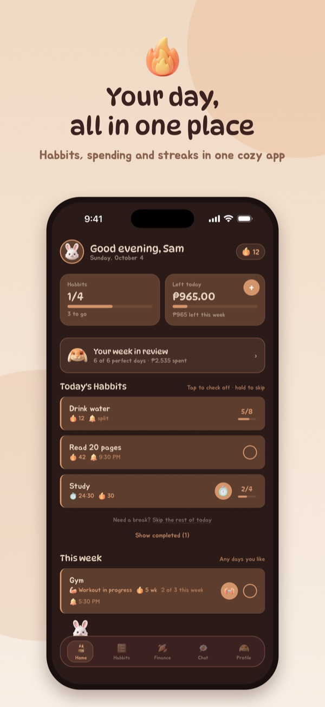
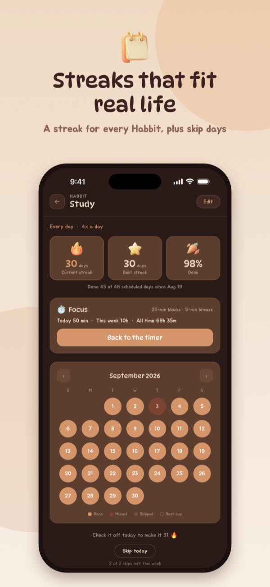
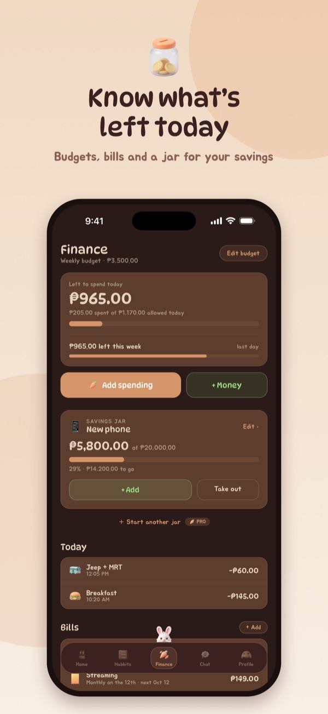
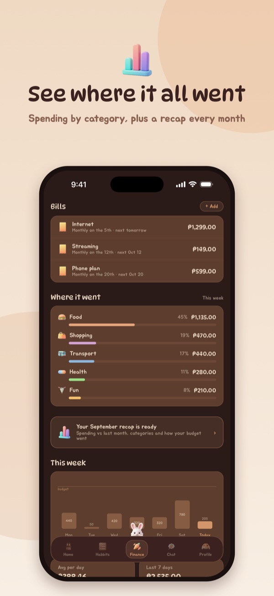
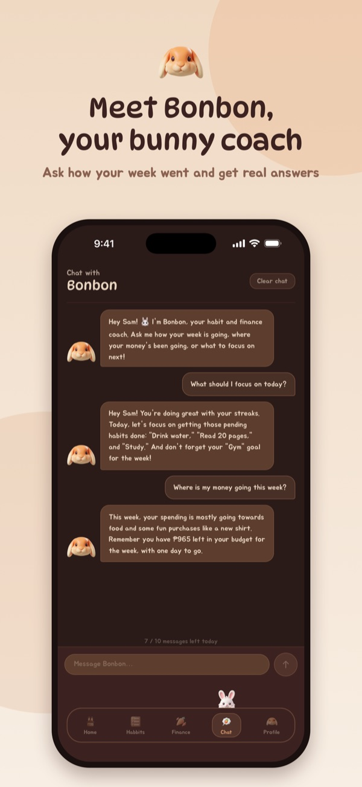
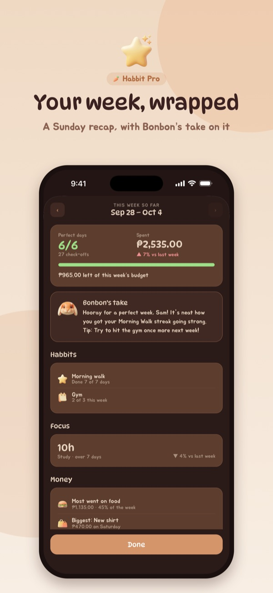
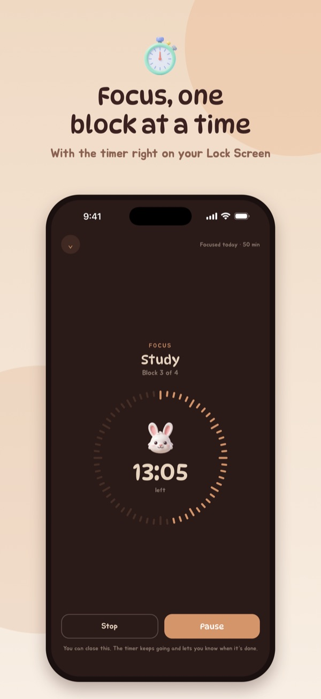
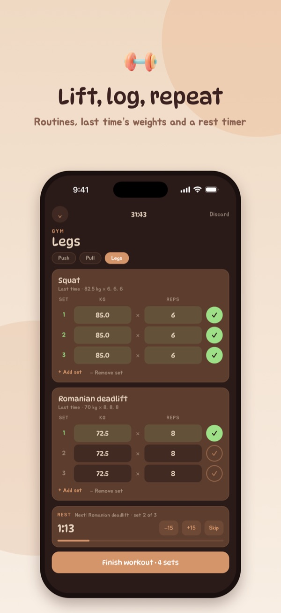

<p align="center">
  
</p>

<h1 align="center">Habbit</h1>

<p align="center">
  A cozy habit tracker and budget buddy in one, with Bonbon, a bunny coach<br />
  who knows how your week is really going.
</p>

<p align="center">
  <a href="https://apps.apple.com/app/id6762041450"></a>
  
  
  
</p>

<p align="center">
  
  
  
  
</p>
<p align="center">
  
  
  
  
</p>

## What it does

**Habits**
- Daily Habbits, "3× a week" goals, or several times a day (like 8 glasses of water)
- A streak for every Habbit, skip days for when life happens, and a next-day tick-off for the one you forgot
- Reminders, and an evening check-in on days with Habbits left
- A calendar, best streak and completion rate for each Habbit, plus achievements along the way

**Focus and workouts**
- A Pomodoro focus timer: rounds and breaks run by themselves, with the countdown on the Lock Screen and in the Dynamic Island
- Quick focus sessions without a Habbit, from Home, the app icon or Siri
- Workout routines that take turns, a rest timer between sets, timed holds like planks, and personal bests

**Money**
- A daily, weekly or monthly budget that shows what's left today
- Scan a receipt to fill in an expense
- Spending categories, bills that log themselves (weekly, monthly or yearly) with reminders ahead of time, and savings jars
- Net worth: what you have and what you owe, month by month
- Log or fix spending on any of the last seven days, see a monthly summary, and export it for a spreadsheet

**Bonbon**
- Ask how your habits went, where your money is going, or what to focus on next
- A recap of your week every Sunday

**Without opening the app**
- Home Screen and Lock Screen widgets: check off Habbits and see your budget
- Siri and Shortcuts: "Log an expense in Habbit", "How much can I spend in Habbit", "Start a focus timer in Habbit"
- Control Center buttons to log an expense or check off the next Habbit, and quick actions on the app icon

**Habbit Pro** (monthly or yearly subscription) adds more Bonbon messages a day, Bonbon's note on your week, your own spending categories, more than one savings jar, extra widget looks, and workout progress.

## Privacy

There's no sign-in, no ads and no tracking. Everything is stored on the iPhone and backed up to the user's own iCloud.

Only Bonbon talks to a server, and only after the user allows it (Bonbon is for people 18 and older). Messages go through this project's own server function to Google's Gemini, with a short summary of the user's week. A scanned receipt is read on the phone; the photo never leaves it, and its text goes to Bonbon only if the user allows that separately. Account balances for net worth are never sent to Bonbon.

The full policy is [here](https://docs.google.com/document/d/e/2PACX-1vRaehJ-88IhMU8NCGtolO_JnG-gJBGN_eze6f3AMwz_5wUFT52NT8pZYG-fmp7t6c3IIcCTfC7WibFn/pub) (source: [`docs/privacy-policy.md`](docs/privacy-policy.md)).

## How it's built

| Part | What it uses |
|---|---|
| App | React Native 0.84 (New Architecture, Hermes), TypeScript, NativeWind |
| Storage | AsyncStorage on the device, and iCloud's key-value store for the backup |
| Notifications | Notifee |
| iOS | WidgetKit widgets and Control Center controls, an ActivityKit Live Activity, App Intents for Siri, Vision for reading receipts, and an App Group shared by the app and its widgets |
| Subscriptions | RevenueCat |
| Bonbon | A Supabase Edge Function calling Gemini 2.5 Flash-Lite, with anonymous sign-in and a daily message limit per user |

```
App.tsx                    the app's state, the day rolling over, and the tabs
src/
  screens/                 Home, Habbits, Finance, Chat, Profile, Settings, onboarding, Pro
  components/              sheets, pickers, charts and the timer and workout screens
  context/                 Pro status, settings, spending categories
  hooks/  utils/           Bonbon, iCloud backup, consent, the Live Activity bridge, …
  *.ts                     the logic as plain functions: streaks, budgets, bills, savings,
                           net worth, receipts, focus rounds, workouts, achievements
ios/
  HabbitWidget/            widgets, Control Center controls, the focus Live Activity
  HabbitIntents.swift      Siri and Shortcuts
  HabbitStore.swift        what Siri and the widgets share with the app (App Group)
  ReceiptScanner.m         camera, photo picker and reading the text on the device
  CloudBackup.m            iCloud backup, and the backup and spending export files
supabase/
  functions/gemini-proxy/  the only server code: Bonbon's messages to Gemini
  migrations/              the table that counts each user's messages per day
__tests__/                 Jest tests for the logic in src/
```

## Running it

You'll need a Mac with Xcode, Node 22.11 or later, and Ruby's Bundler for CocoaPods.

```bash
npm install
bundle install
cd ios && bundle exec pod install && cd ..
```

Bonbon and the anonymous account need a `.env` file in the project root with `SUPABASE_URL` and `SUPABASE_ANON_KEY`. It's git-ignored, so it never gets committed.

```bash
npm start      # Metro
npm run ios    # builds and opens the simulator
```

To run it on your own iPhone, open `ios/DailyTracker.xcworkspace` and, for both the DailyTracker and HabbitWidget targets, pick your team and change the bundle ID and the App Group (`group.com.selrvk.habbit`) to your own.

Tests and type checks:

```bash
npm test
npx tsc --noEmit
```

### Bonbon's server

The server is one Supabase Edge Function. It checks the user's daily limit (10 messages, or 50 with Pro, checked with RevenueCat), builds the Gemini request itself and caps its size.

```bash
supabase link --project-ref <your-project-ref>
supabase db push
supabase secrets set GEMINI_API_KEY=<key> REVENUECAT_SECRET_KEY=<key>
supabase functions deploy gemini-proxy
```

Anonymous sign-ins need to be turned on in the Supabase dashboard. The limits can be changed with the optional secrets `COACH_FREE_DAILY_LIMIT`, `COACH_PRO_DAILY_LIMIT` and `COACH_GLOBAL_DAILY_LIMIT`.

## Android

Habbit is iOS only for now.

## Contact

Questions, ideas or bugs: [selrvk@gmail.com](mailto:selrvk@gmail.com)
